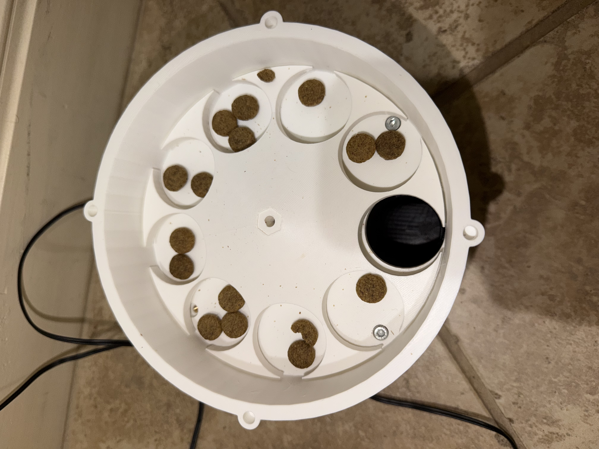
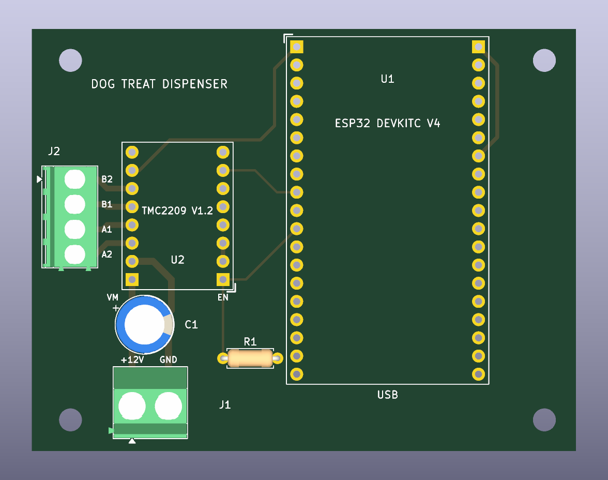

# Wi-Fi Dog Treat Dispenser V2

A 3D-printed dog treat dispenser controlled from a browser on your local Wi-Fi network. An ESP32 serves a control page and drives a stepper motor that rotates the treat wheel. As the wheel turns, treats fall through the opening in the base.

## Build photos

| Assembled dispenser | Treat wheel and dispensing opening |
| --- | --- |
|  |  |

### ESP32 and TMC2209 carrier PCB

## Design files

[View the assembled dispenser in 3D](cad/ViewableAssemblySTL.STL)

- [SolidWorks assembly](cad/SolidWorks%20Files/Assem.SLDASM) and [part files](cad/SolidWorks%20Files/)
- [STL exports for 3D printing](cad/SolidWorks%20Files/STL/), including the base plate, lower plate, treat hopper, spindexer, and spindexer insert

## ESP32 setup

The ESP32 controls a 1.8° bipolar stepper through a TMC2209 in standalone STEP/DIR mode.

| TMC2209 signal | Connection |
| --- | --- |
| STEP | ESP32 GPIO 25 |
| DIR | ESP32 GPIO 26 |
| EN / ENN (active low) | ESP32 GPIO 27 |
| VIO | ESP32 3.3 V |
| GND | Common ground with the ESP32 and motor supply |
| MS1 and MS2 | Both LOW for 1/8 microstepping |

Connect the motor coils to the driver's two output pairs and power the driver from a separate motor supply. Set the current limit using the procedure for your TMC2209 module and the motor's phase-current rating. [TMC2209 datasheet](https://www.analog.com/media/en/technical-documentation/data-sheets/tmc2209_datasheet_rev1.09.pdf)

1. Open the [Arduino sketch](software/WebServerForDogTreatDispensor/WebServerForDogTreatDispensor.ino) in the Arduino IDE and select your ESP32 board.
2. Set `ssid` and `password` in your local copy of the sketch, then upload it to the ESP32.
3. Open the Serial Monitor at `115200` baud and note the IP address printed when the ESP32 connects to Wi-Fi.
4. From a device on the same network, open `http://<ESP32-IP>` and press **Dispense** to rotate the wheel 45° clockwise. The page also offers quarter turns and full turns in either direction.

## Through-hole PCB

Open the [KiCad project](pcb/DogTreatDispensorPCB/DogTreatDispensorPCB.kicad_pro) for the 76 × 59 mm carrier. It uses 2.54 mm socket strips for the 38-pin ESP32-DevKitC V4 (25.4 mm between rows) and the BIGTREETECH TMC2209 V1.2 (12.7 mm between rows). Match the ESP32 USB connector and the driver's VM and EN pins to the labels on the board. [ESP32 dimensions](https://dl.espressif.com/dl/schematics/esp32_devkitc_v4_dimensions.pdf) · [TMC2209 pinout](https://global.bttwiki.com/TMC2209.html#pinoutfunction)

- Power the ESP32 by USB and connect a 12 V DC motor supply to J1, a 5.08 mm pitch screw terminal.
- Connect the two motor coils to the A1/A2 and B1/B2 pairs on J2, a 3.5 mm pitch screw terminal.
- Fit a 100 µF, 35 V radial capacitor at C1 (8 mm body, 3.5 mm lead pitch) and a 10 kΩ axial resistor at R1 (7.62 mm lead pitch).

## License

[MIT](LICENSE)
