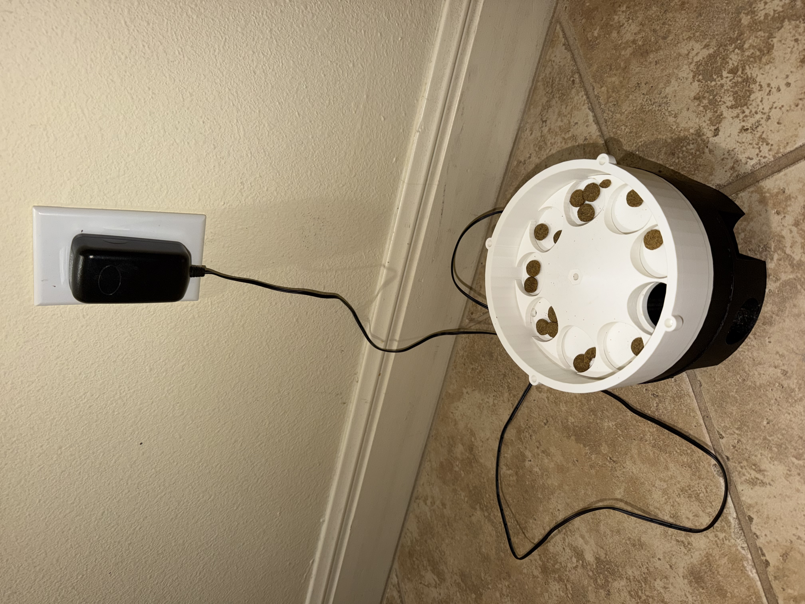

# Wi-Fi Dog Treat Dispenser V2

A 3D-printed dog treat dispenser controlled from a browser on your local Wi-Fi network. An ESP32 serves a control page and drives a stepper motor that rotates the treat wheel. As the wheel turns, treats fall through the opening in the base.

## Build photos

| Assembled dispenser | Treat wheel and dispensing opening |
| --- | --- |
|  |  |

## Design files

- [SolidWorks assembly](cad/Assem.SLDASM) and [part files](cad/)
- [STL exports for 3D printing](cad/STL/), including the base plate, lower plate, treat hopper, spindexer, and spindexer insert

## ESP32 setup

1. Open the [Arduino sketch](software/WebServerForDogTreatDispensor/WebServerForDogTreatDispensor.ino) in the Arduino IDE. Select your ESP32 board and install the Arduino `Stepper` library if needed.
2. Set `ssid` and `password` in your local copy of the sketch, then upload it to the ESP32.
3. Open the Serial Monitor at `115200` baud and note the IP address printed when the ESP32 connects to Wi-Fi.
4. From a device on the same network, open `http://<ESP32-IP>` in a browser. The control page offers quarter turns and full turns in either direction and shows the last commanded movement.

## License

[MIT](LICENSE)
